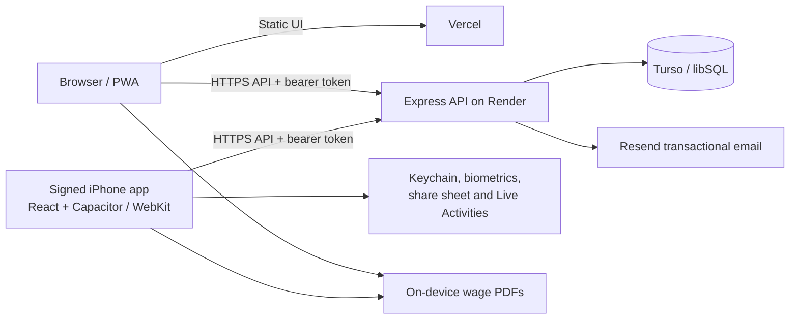

# Wages Tracker

Track work shifts, hourly earnings, fuel allowances, personal spending, and weekly goals. Wages Tracker shares one React/TypeScript application between the responsive web app, installable PWA, and native iPhone app, with an Express API and a Turso database.

[Open the web app](https://wages-tracker-frontend.vercel.app) · [iPhone App Store](https://apps.apple.com/au/app/wagestracker/id6801702467) · [Privacy Policy](https://wages-tracker-frontend.vercel.app/privacy) · [Support](https://wages-tracker-frontend.vercel.app/support) · [GitHub releases](https://github.com/Ezaz-Ahmad/WagesTracker/releases)

## Current delivery status

Last verified **11 October 2026**. A GitHub source release, a TestFlight upload, and a public App Store release are separate delivery milestones.

| Channel | Verified status |
| --- | --- |
| Source and web | **1.22.0**; changes merged through [PR #73](https://github.com/Ezaz-Ahmad/WagesTracker/pull/73); Vercel deployment succeeded |
| iOS beta | **1.22.0 (50)**; Apple validation and TestFlight upload succeeded in [delivery run 38112108372](https://github.com/Ezaz-Ahmad/WagesTracker/actions/runs/38112108372) |
| Public iPhone app | Apple's [Australian listing](https://apps.apple.com/au/app/wagestracker/id6801702467) shows **1.21.0**, published 25 September 2026, under the previous listing name **WagesTracker** |
| API and database | Render API with Turso/libSQL; production health check passed |
| Universal Links | Production association file contains the literal Apple Team ID and app identifier; signed app entitlement inspection passed |
| Android | Planned; no Android application project or Google Play release is committed |

The uploaded beta was built from [`399176d8e48608382376b1e77e9f66e9aa07597e`](https://github.com/Ezaz-Ahmad/WagesTracker/commit/399176d8e48608382376b1e77e9f66e9aa07597e). Apple processing and tester availability were not independently verified after upload. Physical-device testing and App Store review remain separate steps; uploading to TestFlight does not publish an App Store update.

See [1.22.0 release notes](docs/release-notes-1.22.0.md) for the changes and delivery evidence.

## Features

### Shifts, wages, and work locations

- Start and end shifts with a live elapsed timer, or enter and correct saved times. Hours and wages derive from those times and the configured hourly rate.
- Maintain named work locations with addresses and fuel allowances. Saved shifts retain historical location names and allowance snapshots.
- Apply automatic fuel allowance once per branch and worked date, with explicit manual overrides and a restore-to-automatic action.
- Suggest work locations from the previous week's matching weekday and shift order. Suggestions do not create shifts or copy hours.
- Choose any weekday as the weekly boundary and track weekly hours and earnings goals. Changing the boundary preserves dated records and the effective date of weekly extras.
- Review and edit past weeks, compare periods, and export wage PDFs from freshly fetched authenticated records.

Shift and expense writes use the device's validated IANA timezone. Calendar dates stay as local dates, avoiding unintended movement to another day through UTC conversion. Server validation enforces ownership, overlaps, duration, and future-date rules.

### Personal spending

- Record amount, category, and date/time, with optional merchant/title, note, and payment method.
- Use seeded categories or create, edit, archive, and restore custom categories.
- Explore day, week, month, or custom periods with category totals, daily trends, recorded earnings comparisons, and previous-period changes.
- Search and filter expense history, edit or delete transactions, and retry uncertain submissions without creating duplicates.
- Keep personal expenses separate from work/fuel costs. Personal spending is not included in employer-facing wage PDFs.

### Appearance and Settings

- Light, dark, and system appearance, with the approved graphite/obsidian time-to-pay logo and matching native icon and launch assets.
- Customizable Home widgets and navigation order, interactive charts, and an earnings privacy toggle.
- A responsive Settings hub: Profile & preferences, Work & pay, Weekly goals, Security, Data & account, and About.
- About contains clean Privacy Policy and Support rows. The Settings overview contains the developer credit, GitHub/portfolio links, build identity, and a copyright year that updates at runtime.
- Keyboard navigation, focus-managed dialogs, text/table chart alternatives, reduced motion, and mobile touch targets.
- A backend wake-up screen driven by actual health responses, elapsed time, and retry state.

### Native iPhone features

- Optional Face ID/Touch ID login and device-only Keychain storage.
- PDF delivery through Apple's share sheet using temporary app-cache files.
- Optional active-shift Live Activities on supported iOS versions, with elapsed time and a scoped clock-out action. Interactive actions require iOS 17 or later; iOS 16.1–16.x opens the app to clock out.
- Optional Smart Shift Reminders that learn reliable weekday routines from completed history, including historical and corrected shifts. Four consistent occurrences establish a routine; roster changes, gaps, split shifts, and outliers are handled conservatively.
- Reminder actions open the app and require confirmation before changing a shift. Notification permission denial does not prevent normal shift entry.

ActivityKit has system lifetime limits and restart boundaries. See [Live Activity behavior](docs/active-shift-live-activity.md) and [Smart Shift Reminders](docs/smart-shift-reminders.md).

### App Store update reminders

Native iOS compares the actual installed marketing version with Apple's public catalog. A newer public version displays **Installed → Latest**, **Update now**, and **Not now**.

- Update now opens the existing App Store listing.
- Not now postpones prompts for **48 hours**, persisted across launches. A different release during that interval does not shorten the snooze.
- At the reminder deadline, the next foreground check refreshes Apple's latest version. A prompt appears only if the installed version is still older.
- Updating to the current public version stops that release's reminders. Future releases use the same lookup automatically.
- Equal versions, newer TestFlight versions, and offline lookup failures remain silent.

Existing public 1.21.0 installations need one ordinary App Store update to acquire this checker. TestFlight uploads do not trigger public-release prompts. The visible product name is now **Wages Tracker**; the App Store Connect listing name must be updated with the next public review submission. Details: [App Store updates](docs/app-store-updates.md).

## Architecture



The native app embeds its React build; it does not download its startup UI from Vercel. Shared screens, calculations, validation, and API access stay in TypeScript. Platform adapters handle storage, lifecycle, connectivity, deep links, notifications, PDF sharing, and App Store lookups.

The API revalidates client input, derives record ownership from authentication, and is the only component that accesses Turso and Resend. Authenticated state lives in React's `AppContext`; product screens use local state and a lightweight public-path layer rather than an external router or state library.

| Area | Implementation |
| --- | --- |
| Frontend | React 18, TypeScript, Vite 8, plain CSS, jsPDF |
| Backend | Node.js 22, Express 4, TypeScript, zod, JWTs, Argon2id |
| Data | `@libsql/client`; local SQLite in development, Turso in production |
| iOS | Capacitor 8.4.2, Swift Package Manager, native Swift bridges, ActivityKit/WidgetKit |
| Verification | Vitest, Supertest, Testing Library, axe, Playwright, CodeQL, macOS/Xcode checks |

Capacitor Core/iOS/Android are intentionally aligned by root npm overrides. Runtime upgrades require a coordinated dependency change and lifecycle/device regression.

```text
backend/                  API, security policy, email, schema and migrations
frontend/src/screens/     Product and public pages
frontend/src/settings/    Settings panels and account controls
frontend/src/context/     Authenticated client state
frontend/src/lib/         API client, calculations and UI hooks
frontend/src/platform/    Web/native adapters
frontend/src/pdf/         Wage PDF rendering
frontend/src/styles/      Tokens, themes and responsive layouts
frontend/scripts/         Native assets, AASA and release validation
ios/App/                  Xcode app, Swift bridges and widget extension
.github/workflows/        CI, security analysis and iOS delivery
docs/                     Architecture, operations and engineering history
render.yaml               Render deployment configuration
```

The maintained [architecture guide](docs/architecture.md) covers trust boundaries, data entities, authentication, reminders, allowances, and release flow. Older `*-handoff.md` files explain historical changes; their original release status is not the current status.

## Local development

Use **Node.js 22 or later** and npm from the repository root. The root lockfile installs both workspaces.

```bash
npm ci
cp backend/.env.example backend/.env
npm run dev
```

On PowerShell, replace the copy command with:

```powershell
Copy-Item backend/.env.example backend/.env
```

Open `http://localhost:5173`. The backend listens on `http://localhost:4000`; Vite proxies `/api` locally. With Turso variables unset, the API uses `backend/data/wage-tracker.sqlite`. No hosted database or mail account is needed for development.

Development defaults to console mail delivery so recovery/verification links can be used locally. Console and memory transports are refused in production.

| Command from repository root | Purpose |
| --- | --- |
| `npm run dev` | Run both workspaces in watch mode |
| `npm run typecheck` | Type-check backend and frontend |
| `npm test` | Backend/frontend tests plus Universal Link generator tests |
| `npm run build` | Build backend and frontend |
| `npm run test:smoke -w frontend` | Build and run production-browser smoke tests |
| `npm run verify:libsql` | Check native libSQL package alignment |
| `npm run verify:capacitor` | Check Capacitor dependency alignment |
| `npm run ios:testflight:verify -w frontend` | Validate version and signed-delivery configuration without secrets |

### iOS development and builds

The native display name is **Wages Tracker**. The registered bundle ID remains `com.ezazahmad.wagestracker`; the embedded extension is `com.ezazahmad.wagestracker.ShiftActivityExtension`. The app targets iPhone and iOS 15 or later; individual native features have higher minimum versions.

| Command from repository root | Purpose |
| --- | --- |
| `npm run ios:build:web` | Build the iOS target against the pinned production HTTPS API |
| `npm run ios:copy:web` | Build and copy web assets into the native app |
| `npm run ios:sync` | Build, copy, sync plugins, and normalize SPM paths |
| `npm run ios:assets -w frontend` | Regenerate approved native icon/splash assets |
| `npm run ios:assets:verify -w frontend` | Check exact asset set, pixels, dimensions, and metadata |
| `npm run ios:resolve:native` | Resolve Swift packages; requires macOS/Xcode |
| `npm run ios:build:simulator` | Build an unsigned Simulator app; requires macOS/Xcode |

Production native builds reject live-reload URLs, debug overlays, missing/incorrect API origins, and duplicate Capacitor runtimes. GitHub's macOS workflow provides native compilation for contributors without a Mac.

## Configuration

Copy example files when needed; do not commit local secrets. Every `VITE_` value is public in the frontend bundle.

### Backend

| Variable | Purpose / default |
| --- | --- |
| `PORT` | HTTP port; `4000` |
| `NODE_ENV` | `development` locally; `production` on Render |
| `JWT_SECRET` | Strong server secret required in production; default/dev values are rejected |
| `DB_PATH` | Local SQLite path; `./data/wage-tracker.sqlite`, resolved in the backend workspace |
| `TURSO_DATABASE_URL`, `TURSO_AUTH_TOKEN` | Hosted database connection; required for durable production storage |
| `ALLOWED_ORIGINS` | Exact production allowlist: `https://wages-tracker-frontend.vercel.app,capacitor://localhost` |
| `ADMIN_PASSWORD` | Optional separate admin credential; unset disables admin login |
| `ARGON2_MEMORY_COST_KIB` | `19456` |
| `ARGON2_TIME_COST` | `2` |
| `ARGON2_PARALLELISM` | `1` |
| `RESEND_API_KEY` | Server-only transactional email API key |
| `MAIL_FROM` | Sender on a verified domain, for example `Wages Tracker <no-reply@example.com>` |
| `MAIL_REPLY_TO` | Optional reply/support address |
| `APP_BASE_URL` | Public HTTPS frontend origin for reset and email-change links |
| `MAIL_PROVIDER` | Inferred transport; production uses Resend |
| `RATE_LIMIT_AUTH` | Signup/login requests per IP per 15 minutes; `20` |
| `RATE_LIMIT_FORGOT_PASSWORD_IP` | Reset-email requests per IP per 15 minutes; `5` |
| `RATE_LIMIT_FORGOT_PASSWORD_EMAIL` | Reset-email requests per address per hour; `3` |
| `RATE_LIMIT_RESET_PASSWORD` | Reset validation/submission requests per IP per 15 minutes; `15` |

The API remains available when production mail is unconfigured, but recovery requests return a uniform `503 EMAIL_UNAVAILABLE` rather than claiming a message was sent. See [backend/.env.example](backend/.env.example).

### Frontend and build process

| Variable | Purpose |
| --- | --- |
| `VITE_API_URL` | Production API origin; leave blank locally for the Vite proxy |
| `VITE_APP_TARGET` | `web` by default; native scripts supply `ios` |
| `VITE_CAPACITOR_SERVER_URL` | Development-only live reload; rejected in native production |
| `VITE_VIEWPORT_DEBUG` | Browser diagnostic overlay when `true`; rejected in native production |
| `APPLE_TEAM_ID` | Public 10-character Apple Team ID used by the AASA generator; required for Vercel Production |
| `VERCEL_ENV` | Set by Vercel; `production` enables the association-file guard |
| `REQUIRE_APPLE_TEAM_ID` | Set `true` to enforce the same guard outside Vercel |

The last three are build-process variables, without a `VITE_` prefix. Never put database tokens, mail keys, JWT secrets, admin credentials, or Apple signing keys into the frontend or iOS source. See [frontend/.env.example](frontend/.env.example) and the [secret-placement guide](docs/architecture.md#secret-placement).

## Authentication and password security

- New accounts validate email shape and likely provider typos without silently changing the address. Signup creates a session immediately; it does not require a confirmation email. Changing an existing email requires the current password and confirmation at the new address.
- New/changed passwords require 15–128 Unicode code points, permit spaces and Unicode, and use a weak-password blocklist. Existing shorter passwords remain valid for login.
- New password hashes use Argon2id. Legacy bcrypt hashes are verified and upgraded on successful login.
- Password changes rotate the current session, return its replacement token in `X-New-Token`, invalidate outstanding reset links, and revoke earlier sessions.
- Recovery tokens contain 32 random bytes, expire after 25 minutes, and are stored only as keyed HMAC-SHA-256 digests. New requests supersede older links.
- Reset links carry the token in a URL fragment, which is consumed into memory and removed before the page renders. Completion atomically consumes it, changes the password, and revokes sessions; the user then signs in normally.
- Neutral reset responses, detached email delivery, and independent rate limits reduce account enumeration and mail flooding.

### Sessions

Every regular-user JWT must pass signature, expiry, token-version, and database-session checks. Sessions are scoped to the account and installation, individually revocable, and listed under Settings → Security.

Ordinary sessions have a **30-day absolute lifetime** and a **10-minute server-enforced idle timeout**. Login rotates the previous session for that installation. At most ten installations remain signed in; a new login beyond that limit revokes the least recently active other installation.

Web Remember Me uses local storage; session-only web login uses session storage. Native Remember Me uses device-only Keychain storage, while session-only native login stays in memory.

### Biometric login (Face ID / Touch ID)

Native iOS biometric login is optional and account/device scoped. The password is never stored on the device. Metadata and bearer credentials use separate Keychain items; credential access is guarded by the current biometric enrollment and device passcode. A successful biometric unlock still requires backend validation.

Enabling protection rotates the session to a **five-year absolute lifetime**, exempts it from ordinary idle expiry, and demotes ordinary Remember Me persistence. Disabling protection restores the ordinary session policy. Revocation, password changes, account deletion, and token-version checks still apply.

**Log out while biometric login is enabled acts as a local soft lock:** it clears the ordinary local token but retains the protected credential and backend session for the next biometric unlock. Ordinary logout revokes the session. Password changes, current-session revocation, account deletion, or invalid biometric enrollment clear the saved credential.

The [biometric session guide](docs/biometric-5-year-session-handoff.md), [account-scoping fix](docs/biometric-account-scoping-fix.md), and [native recovery fix](docs/ios-white-screen-after-faceid-fix.md) document the implementation history. Actual Face ID/Touch ID and Keychain behavior require physical-device verification.

## Admin panel

The admin panel is a separate browser application at **`/admin`**, available at [the production admin URL](https://wages-tracker-frontend.vercel.app/admin) or `http://localhost:5173/admin` during local development. It is not linked from the user-facing app. Access requires the backend's shared `ADMIN_PASSWORD`; a normal user's email/password does not grant admin access.

### Setup and login

1. Set a strong, unique `ADMIN_PASSWORD` in `backend/.env` for local development, or in the Render backend service's environment for production. Keep it on the server; never put it in a frontend variable or commit it to Git.
2. Restart the local backend or redeploy the Render service after changing the environment, then open `/admin` and enter that password.
3. Leave `ADMIN_PASSWORD` unset to disable new admin logins. There is no default admin password or admin account to create through signup.

### Account management

- **User directory:** search by name or email, with total-user/shift counts and each user's name, email, work location, hourly rate, weekly goals, shift count, and join date. The layout adapts to smaller screens.
- **View account:** open a user's work settings and shift history, including dates, locations, and sign-in/sign-out times.
- **Edit login email:** validate and normalize the address, suggest corrections for likely domain typos, and reject addresses already used by another account. The password, signed-in sessions, settings, and shift records are retained. An admin-applied address is marked verified, pending verification links are invalidated, and security notifications are attempted to both the old and new addresses.
- **Delete account:** the UI requires typing the user's email in a confirmation dialog. Deletion permanently removes the profile, settings, sessions, password-reset/email-verification records, shifts, work expenses/extras/locations, personal expenses, and spending categories.

### Authentication and data access

`POST /api/admin/login` is limited to **10 attempts per IP per 15 minutes**. A successful login issues a JWT with `role: "admin"` and a **12-hour expiry**. The frontend stores it under its own `wageTracker.adminToken` key, separate from regular-user authentication; expired or rejected credentials require signing in again.

User listing/detail, email editing, and deletion under `/api/admin` require the server's separate `requireAdmin` middleware. A valid ordinary-user JWT receives `403` on those routes. Admin responses use explicit public-data mappings, so password hashes and session bearer credentials are not exposed. The panel's unlisted URL does not replace these authorization checks. See [admin routes](backend/src/routes/admin.ts), [admin authentication](backend/src/auth.ts), and [the admin UI](frontend/src/admin/AdminDashboard.tsx).

## Data and privacy

The API uses parameterized queries and account-scoped access. Work records, work expenses, and weekly extras older than five years are pruned. Personal expenses remain until individually deleted or the account is deleted. Account deletion removes dependent account records, sessions, reset/verification records, shifts, expenses, and categories.

Wage reports are generated on the device from refreshed work records. PDF files are not stored by the backend and do not contain personal spending. Native sharing uses temporary cache files and the system share sheet.

The App Store update lookup sends only fixed public app/storefront identifiers, with ordinary connection metadata. It does not send Wages Tracker session, account, shift, or spending data. There is no bank connection, advertising SDK, or application analytics integration.

The public [Privacy Policy](https://wages-tracker-frontend.vercel.app/privacy) and [iOS privacy mapping](docs/ios-privacy-mapping.md) describe collected data, native APIs, and review requirements.

## Testing and CI

Verified for the 1.22.0 uploaded source in [build 50](https://github.com/Ezaz-Ahmad/WagesTracker/actions/runs/38112108372):

| Check | Result |
| --- | --- |
| Backend Vitest | **294 tests** across 31 files |
| Frontend Vitest | **853 tests** across 108 files |
| Universal Link generator | **3 tests** |
| Total in `npm test` | **1,150 tests** |
| Distribution-entitlement regression suite | **8 tests** |
| Production-browser smoke suite | **14 scenarios**, verified by frontend PR CI |
| Native Live Activity previews | **40 layouts**, verified by macOS Simulator CI |
| Type checks, builds, asset/config inspection, and CodeQL | Passed for the uploaded source |

Test counts are a dated snapshot; current CI output is authoritative. Backend tests use isolated temporary SQLite databases. Component tests cover actual screens, focus, dialogs, accessibility, authentication, native adapters, reminders, and update prompts. Browser tests exercise the built production bundle.

[CI](.github/workflows/ci.yml) runs backend/frontend jobs on pushes and PRs to `main`. [CodeQL](.github/workflows/codeql.yml) analyzes JavaScript/TypeScript, Actions, and Swift. [Simulator CI](.github/workflows/ios-simulator.yml) builds and inspects an unsigned app, renders native layouts, and retains diagnostic artifacts.

Physical iPhone testing is still required for Face ID/Touch ID, Universal Links from Mail, real email delivery, background behavior, ActivityKit limits, and Safari/Home Screen keyboard/safe-area behavior. Automated previews cannot prove those device outcomes.

### Dependency maintenance

As checked on 11 October 2026, GitHub Dependabot reports **35 open alerts**: 8 critical, 11 high, 11 medium, and 5 low, across runtime and development dependencies. Ten dependency-update PRs remain open. This documentation maintenance does not apply those updates, and passing CI/CodeQL does not resolve dependency advisories. See [dependency alerts](https://github.com/Ezaz-Ahmad/WagesTracker/security/dependabot) and [open dependency PRs](https://github.com/Ezaz-Ahmad/WagesTracker/pulls?q=is%3Apr+is%3Aopen+author%3Aapp%2Fdependabot).

Prioritize security fixes and regression verification, including a coordinated Capacitor patch across the pinned npm packages and Swift runtime, before the next public release. Alert counts and package versions are dated observations; the live GitHub queue is authoritative.

## Versioning and releases

### How the release version is chosen

The public marketing version uses **`MAJOR.MINOR.PATCH`**, with the increment chosen for the combined scope of a release:

| Change being released | Version change | Example |
| --- | --- | --- |
| Breaking change or fundamental redesign | Increase major; reset minor and patch | `1.22.0` → `2.0.0` |
| New functionality compatible with existing use | Increase minor; reset patch | `1.21.1` → `1.22.0` |
| Compatible bug fix, UI polish, or security fix | Increase patch | `1.22.0` → `1.22.1` |
| Documentation-only maintenance | Keep the current marketing version | `1.22.0` remains `1.22.0` |

Every release containing application code, UI, feature, or behavior changes receives a new marketing version. Several commits can belong to one release, so **the marketing version is deliberately updated by hand, not automatically incremented on each commit**. The current **1.22.0** is a minor release because it adds App Store update prompts, alongside the visible name change to Wages Tracker. The examples above explain the policy; they do not announce future releases.

### What updates automatically

| Identifier | Source and update trigger | Where it appears |
| --- | --- | --- |
| Marketing version, e.g. `1.22.0` | Chosen for the release in `frontend/package.json` | Settings, PDF footer, and native app version |
| Short commit hash | `git rev-parse --short HEAD`, captured on each frontend build | Settings and PDF footer, identifying the built source |
| Commit date | `git log -1 --format=%cI`, captured on each frontend build | Settings, alongside the version and hash |
| TestFlight build number, e.g. `50` | `github.run_number` from each **fresh** signed workflow dispatch | Apple/TestFlight build identity, e.g. `1.22.0 (50)` |

[Vite's build configuration](frontend/vite.config.ts) injects `__APP_VERSION__`, `__BUILD_HASH__`, and `__BUILD_DATE__`; [appVersion.ts](frontend/src/lib/appVersion.ts) formats them. Settings shows `v<version> (<hash>) · <commit date>`, while the PDF footer uses `v<version> (<hash>)` beside the report's own generation date.

Building a new commit automatically refreshes the source hash/date, even when the marketing version stays the same. Rebuilding the same commit preserves that source identity. The Settings date is the **source commit's date**, not the deployment date. A commit alone does not change an installed iPhone app; it continues to show the metadata bundled with its installed binary until the user installs an updated build.

TestFlight build numbers are separate from semantic versions, so multiple test builds can share one marketing version. Do not use **Re-run jobs** for signed delivery; the workflow rejects reruns to avoid reusing a build number. Fix the cause and dispatch a new run.

### Preparing a version change

[`frontend/package.json`](frontend/package.json) is the release source of truth. Before delivering a new application release:

1. Choose the next marketing version using the release's scope above, and update `frontend/package.json` plus the frontend workspace entry in the root [`package-lock.json`](package-lock.json).
2. Set the same `MARKETING_VERSION` in **all four** app/Live Activity extension Debug and Release configurations in [`project.pbxproj`](ios/App/App.xcodeproj/project.pbxproj).
3. Set the GitHub repository's **Settings → Environments → testflight → Environment variables → `IOS_APP_VERSION`** to that same value.
4. Review `git grep` results for the previous version. Update current metadata and release documentation while retaining intentionally historical notes.
5. Run `npm run ios:testflight:verify -w frontend` and the release checks in the [TestFlight delivery guide](docs/ios-testflight-delivery.md) before a fresh dispatch from protected `main`.

[`verify-testflight-config.mjs`](frontend/scripts/verify-testflight-config.mjs) derives the expected version from package metadata and checks the lockfile, Xcode release invariants, and signed-workflow configuration. The signed workflow also compares the actual environment's `IOS_APP_VERSION` with the package version and stops if they differ; a GitHub variable cannot be validated from local files alone.

A GitHub release tag should identify the exact application source it describes. `v1.22.0` identifies the source used for 1.22.0 (50); subsequent documentation commits do not change that uploaded binary.

Work enters through `codex/*` branches and pull requests against protected `main`. Required CI checks must pass before merge. GitHub automatically deletes merged PR head branches; active dependency PR branches remain until reviewed and resolved.

### TestFlight delivery

[The signed workflow](.github/workflows/ios-testflight.yml) is manual-only, restricted to protected `main`, and uses the protected `testflight` environment. It verifies metadata, tests, builds, assets, native integration, signing profiles, exported entitlements, and Apple's package validation before upload. Signing credentials and the IPA are removed from the ephemeral runner afterward.

The workflow does not assign testers, submit App Review, select a public App Store build, or release the app publicly. Use the [delivery guide](docs/ios-testflight-delivery.md) for environment setup, a fresh dispatch, processing/tester checks, device regression, and recovery.

## Deploying

Production uses **Vercel + Render + Turso**.

1. Create the Turso database and configure `TURSO_DATABASE_URL` and `TURSO_AUTH_TOKEN` on Render. Keep local SQLite for development.
2. Deploy the root [Render Blueprint](render.yaml). It builds the backend workspace, starts the Node API, sets the exact web/native CORS origins, and checks `/api/health`.
3. Configure `JWT_SECRET`, production database credentials, and Resend's `RESEND_API_KEY`, verified `MAIL_FROM`, and HTTPS `APP_BASE_URL`. Add `MAIL_REPLY_TO` or `ADMIN_PASSWORD` if needed.
4. Import the frontend into Vercel with **Root Directory = frontend**, `VITE_API_URL=https://wage-tracker-api.onrender.com`, and the literal `APPLE_TEAM_ID` for Production. [frontend/vercel.json](frontend/vercel.json) supplies the build, SPA fallback, and association-file headers.
5. Check the web application, [API health](https://wage-tracker-api.onrender.com/api/health), and [Universal Link association file](https://wages-tracker-frontend.vercel.app/.well-known/apple-app-site-association), then verify recovery through a real mailbox and physical iPhone.

The Render build includes development dependencies needed for TypeScript compilation. Production data lives in Turso, so an ephemeral Render filesystem is not the data store. A missing Apple Team ID fails the Vercel production build instead of publishing a placeholder.

Alternative Railway/Netlify configuration files are reference options, not the current deployment. Native distribution follows the separate TestFlight/App Store process above.

## Documentation and next steps

| Guide | Scope |
| --- | --- |
| [Architecture](docs/architecture.md) | System, data, security boundaries and delivery diagrams |
| [1.22.0 release notes](docs/release-notes-1.22.0.md) | Changes, source commit and verified upload |
| [TestFlight delivery](docs/ios-testflight-delivery.md) | Signing setup, processing, device checks and recovery |
| [App Store updates](docs/app-store-updates.md) | Installed/latest comparison, 48-hour snooze and rollout |
| [Live Activities](docs/active-shift-live-activity.md) | Native surfaces, scoped clock-out and platform limits |
| [Smart Shift Reminders](docs/smart-shift-reminders.md) | Learning, roster adaptation and safe actions |
| [iOS privacy mapping](docs/ios-privacy-mapping.md) | Data collection, native API usage and review checklist |

The next iOS milestone is resolving pending dependency security updates, completing physical-device regression, confirming tester availability, updating the public listing name and review metadata, and explicitly submitting the chosen build to App Review. Android delivery remains future work.

Built by [Ezaz Ahmad](https://www.ezazahmad.com/).
