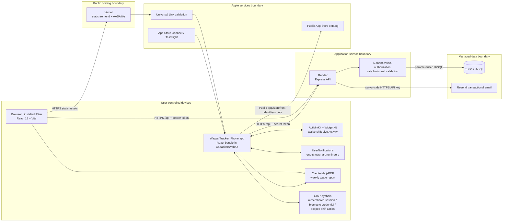
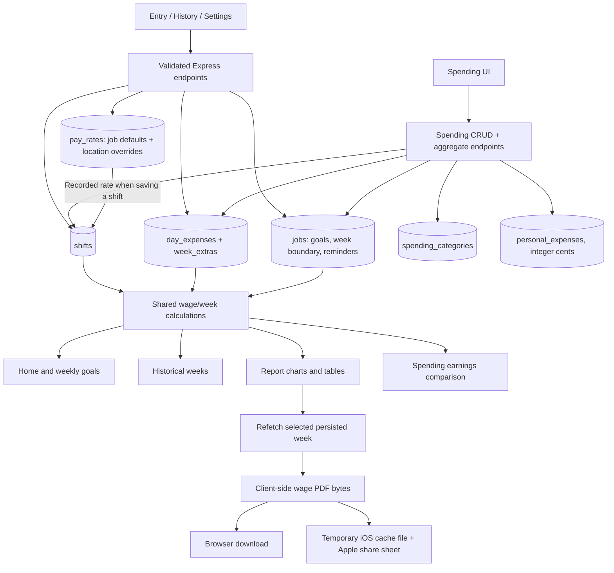
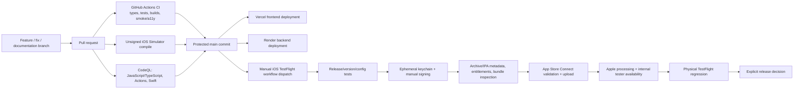

# Wages Tracker architecture

**Applies to:** 1.28.0 application source

**Last reviewed:** 23 November 2026

This document describes the deployed web/PWA system, the Capacitor iOS application, the security boundaries, and the delivery pipeline. Source code and automated checks remain authoritative if a diagram and implementation ever differ.

## Runtime system and trust boundaries



The browser and native web view are untrusted clients. They may provide helpful validation, but the Express API revalidates every request, derives ownership from the authenticated session, and is the only component allowed to access Turso or Resend. Vercel serves the browser/PWA assets and the public AASA file. The iOS application embeds its synchronized React build inside the signed application, so normal app startup does not load its UI from Vercel. No server credential belongs in either bundle. PDFs are generated from authenticated data on the device and are not uploaded as files to the backend.

The iOS container uses Capacitor **8.6.2** and one UIKit scene-owned window/bridge. Simulator and signed builds use stable Xcode **27.2**, with the compiled app and widget independently checked for SDK 27 or newer. Swift CodeQL uses its supported analysis-only toolchain without signing credentials; its output cannot be used for distribution.

Fonts ship with the application. Production web headers restrict framing, MIME sniffing, referrers, base URLs and object content. The API applies rate limits before body parsing, rejects unnecessary compressed bodies and returns safe parser errors. Client requests have connection/body deadlines; uncertain writes are not automatically retried.

## Device layout preferences

Home widgets, navigation order, and hidden tabs are stored under the existing per-account/device `wagesTracker.layout.v1:<userId>` local-storage key. Older layouts default to all tabs visible. Invalid, duplicate, and stale IDs are normalized; Settings cannot be hidden. Hidden tabs are omitted from mobile, desktop, swipe navigation, and screen selection, with an available-screen fallback when another window updates the layout. Hiding Spending also disables the Home spending snapshot and summary fetch while preserving its separate widget preference. These preferences do not write account, shift, or expense data and do not alter wage calculations. See [tab visibility](tab-visibility.md).

## Authentication, sessions, biometrics, and recovery

```mermaid
sequenceDiagram
  participant C as Web / iOS client
  participant A as Express API
  participant D as Turso
  participant K as iOS Keychain
  participant E as Resend

  C->>A: Signup or login (email + password)
  A->>D: Verify Argon2id/legacy bcrypt; create session
  A-->>C: JWT containing session id + token version
  C->>K: Optional remembered or biometric-protected session (iOS only)
  C->>A: Authenticated request with bearer JWT
  A->>D: Verify JWT, token version, session state/expiry
  A-->>C: User-owned data only

  C->>A: POST /auth/forgot-password (email)
  A-->>C: Neutral response for known/unknown/malformed addresses
  A->>D: For a real account, store keyed digest of random one-use token
  A->>E: Send fragment-based reset link
  E-->>C: Email link /reset-password#token=...
  C->>A: Validate token and submit policy-valid new password
  A->>D: Atomically consume token, replace hash, increment token version, revoke every session
  A-->>C: Reset success; old password and old sessions no longer work
```

- New passwords use Argon2id. Legacy bcrypt hashes are verified only for migration and are replaced after a successful login.
- Ordinary sessions are database-backed and JWTs carry both a session id and `tokenVersion`; revocation, password change, password recovery, and account deletion invalidate them before JWT expiry.
- Ordinary sessions expire after 30 days or 10 minutes of inactivity. Biometric-protected sessions rotate to a five-year absolute lifetime and skip ordinary idle expiry; explicit revocation and token-version checks still apply.
- The iOS biometric plugin stores metadata separately from the bearer credential. The protected credential is device-only Keychain data guarded by the current biometric set and device passcode. The password itself is never stored.
- Biometric-enabled logout is a local soft lock that retains the protected credential and backend session; ordinary logout revokes the session. Disabling biometrics, changing passwords, revoking the current session, or deleting the account clears the relevant credential.
- Signup validates the email and likely domain typos without an ownership-confirmation email. An authenticated email change requires the current password and a one-use verification link at the proposed new address.
- Recovery tokens are 32 random bytes. Only a domain-separated HMAC-SHA-256 digest keyed by the backend application secret is persisted. A token works once, expires after 25 minutes, and is superseded by a newer request.
- Forgot-password responses and asynchronous delivery behaviour avoid confirming whether an account exists. Per-IP and hashed per-address rate limits reduce enumeration and mail flooding.

## Wage, shift, spending, and report data flow



Shift times, plain calendar dates and recorded pay snapshots are the source data; hours and earnings are derived. Completed wages multiply elapsed seconds by integer rate cents, round once per shift and sum. Later pay changes do not rewrite saved or running shifts. Personal spending is separate from work/fuel inputs and employer-facing wage PDFs. Dates are validated with the device IANA timezone and amounts use integer cents at API/persistence boundaries. Weekly extras retain an effective date so changing a job's week-start preference can re-key them without drifting their attribution.

### Job scope, pay and deletion

`X-Work-Job` selects an owned job; an omitted header uses the primary job for older clients. Explicit `all` is a combined read-only scope, apart from finishing a specific owned running shift. Each job owns its locations, effective-dated pay rates, goals, work-week boundary, reminders, shifts, fuel and extras. Combined reports use one Monday–Sunday interval and allocate extras by effective date. The personal ledger stays account-wide with optional job tags.

New shifts resolve the worked date against the location's latest applicable pay record, inheriting the job default when appropriate, then persist the rate, source and job-name snapshot. Location changes and manual rate corrections require review when the applied rate changes; times-only edits keep it. User views, PDFs and admin use the same per-shift calculation. The legacy migration pins old shifts to the known account rate because earlier pay history was never recorded.

Permanent job deletion requires an impact preview and exact job-name confirmation. A running shift blocks deletion. One transaction removes that job's work records, locations, rates and explicitly tagged personal spending; other jobs and unlinked spending remain. A primary replacement and compatibility preferences update atomically. Deleting the final job or only active job is refused inside the same write transaction, before any cascade. Competing deletions therefore preserve one usable job. The UI offers an add-job handoff, and stale clients receive `409 LAST_JOB_REQUIRED` with a readable explanation. Existing accounts already empty from an earlier version retain their add-job recovery and initialization marker. See [jobs, location pay and reporting](multi-job-workspaces.md).

### Conflict and error feedback

Overlap checks and the one-running-shift limit apply across all jobs, including transaction rechecks. The API returns a bounded, whitelisted conflict object containing only the caller's necessary job/location/date/time fields. The client validates it before comparing the attempted change with saved work, including overnight end dates. Scoped Lock Screen action tokens cannot retrieve other schedules; their error asks the user to review the app.

Consumer and admin clients classify validation, authentication, network, timeout, service and concurrency failures into specific guidance. The shared alert dialog coalesces duplicates, retains newer errors while an older instance closes, and respects reduced motion. Only the top focus trap owns Escape/Tab; reference-counted scroll locks survive editors unmounting beneath a warning. Failed saves preserve input, and late completions cannot clear newer time drafts.

### Active-shift lifecycle and trust boundary

An open shift remains an ordinary `shifts` row and the API remains authoritative. The native system surface is an explicit, default-off preference stored per account and installation. When enabled and a native iOS client creates or reloads an open shift, the backend issues a seven-day JWT whose audience, purpose, user and shift claims restrict it to `POST /api/shifts/:id/clock-out-action` for that exact shift. This is not a user session: it cannot read profile data, list shifts or call any other account route. The app stores it as device-only Keychain data so the system Live Activity never receives the full bearer session. Disabling the preference dismisses the surface without ending the shift or discarding an already-confirmed offline clock-out.

ActivityKit renders elapsed time from the shift's absolute start date, using the same overnight-start rule as `useLiveElapsedHours`; it performs no timer writes. Clock-out from the authenticated UI and from the scoped native action converge on one conditional `UPDATE ... WHERE sign_out IS NULL` transaction. Consequently, only the first accepted finish time wins, while repeated taps and background replays return the same completed row. The native action captures that time once, persists it, and submits it with an iOS-owned background upload that waits for connectivity. Failure leaves the activity in a retry state; success ends it, reports final duration and triggers a dashboard refresh when the WebView is alive.

The embedded `ShiftActivityExtension` contains presentation code and intent metadata. The `LiveActivityIntent` executes in the application process, requires device authentication and confirmation, and reaches the coordinator through the app target. See [`active-shift-live-activity.md`](active-shift-live-activity.md) for the iOS-version matrix, ActivityKit's eight-hour limit, restart boundary, separate extension signing and the Android foreground-service design that is still required.

### Smart-reminder lifecycle

Smart reminders are a per-job, default-off preference and a device notification capability. The React layer learns each job's completed shift history, including historical/manual entries and corrected times. At least four reliable occurrences on a weekday are needed. The latest twelve usable occurrences, recent cadence, and time agreement determine reliability; split-shift dates, extreme durations, irregular attendance and statistical outliers are excluded.

Four consistent shifts at new hours replace an older routine; two conflicting shifts pause an uncertain routine. A three-week weekday gap starts a fresh learning era, and a routine whose last sample is more than fourteen days old stays silent. No API eligibility flag is used to exclude historical shifts from the current learner.

The iOS bridge receives a bounded set of one-shot notification requests covering the next seven local calendar days and the currently open shift. Requests and actions identify their job, and schedules refresh after authenticated shifts change. A running shift suppresses another job's start action. Notification actions do not receive a session token and do not call the API: Sign In/Sign Out foreground the app and produce a pending job intent, which the React confirmation dialog rechecks before an explicit confirm tap can write anything. See [`smart-shift-reminders.md`](smart-shift-reminders.md).

### Public App Store update detection

The native adapter reads the installed marketing version through the existing App plugin and uses Capacitor's core HTTP bridge to query Apple's public catalog for App Store ID `6801702467`. It checks both that ID and the stable bundle ID before accepting a numeric newer version. No account token or wage/spending data is sent.

Foreground checks share an in-flight request, cache successful lookups for six hours, and quietly retry failed lookups after fifteen minutes. Not now persists a public version and dismissal timestamp for a full 48-hour snooze. At its deadline a fresh lookup supplies the current latest version; equal versions and newer TestFlight versions never prompt. See [`app-store-updates.md`](app-store-updates.md) for lifecycle and rollout details.

### Work locations and allowance invariants

`work_locations` belongs to an account and job. `GET /api/work-locations` returns active locations in the selected job (with `includeArchived=true` for settings); `POST`, `PATCH`, and `DELETE` create, edit, restore, and archive only owned rows in that scope. Names are normalized per job for duplicate detection, and fuel allowances are stored as integer cents with a two-decimal/$10,000 boundary. Location archival preserves history; permanent job deletion is a separate operation.

Every saved shift stores both the location ID and immutable `location_snapshot`/`fuel_allowance_snapshot_cents` values. The migration creates active rows from legacy profile fields, creates archived rows for historical-only names, and links old shifts using the same whitespace/case normalization as new writes. Editing or archiving a location therefore cannot rewrite a historical report. `GET /api/work-locations/suggestions?weekStart=YYYY-MM-DD` returns only persisted IDs from the prior week's same weekday and shift order; the client uses these only as unsaved UI defaults.

Entry presents those IDs through a responsive modal/bottom-sheet picker rather than a plain native select. The active-location list shows the address and current default allowance; an archived selection is rendered as historical context but cannot be chosen for a new shift. A suggested or selected location may preview its declared allowance, but that preview is not persisted and does not contribute to totals until a real shift with a sign-in is saved. The picker also provides a direct route to Work & pay settings for the empty or maintenance case.

`day_expenses` keeps `automatic_fuel_cents` and optional `manual_override_cents` alongside the effective `fuel_cost`, scoped by account, job and date. A recalculation groups worked shifts by branch and date, charges each branch at most once, and preserves the shift snapshot. `PUT /api/day-expenses/:date` is an explicit manual override/restore operation in the selected job. The response includes the effective amount and source metadata (`automatic`, `manual`, `mixed`, or legacy `recorded`) so reports and PDFs can explain where an allowance came from.

## Delivery and release flow



`frontend/package.json` owns the marketing version; the lockfile, all four app/extension Xcode configurations, GitHub environment, displayed app metadata, and documentation must match. `github.run_number` becomes the unique TestFlight build number. A pre-upload delivery failure is followed by a fresh dispatch, never **Re-run jobs**. If upload succeeded and only availability verification failed, inspect the existing build with the separate read-only check instead of uploading again. Internal TestFlight delivery does not submit App Review or publish an App Store update.

Release tags identify the exact signed application source. Version **1.27.0 (58)** uses `d5cdd4a859ea5aa5ef1414de1a6edba7c1a77a10`; later documentation commits do not change the binary. Production `/api/health` returns the same validated public source SHA in `X-App-Revision` when Render provides it, with `Cache-Control: no-store`, so rollout can be checked independently of deployment callbacks.

## Data entities

| Entity | Purpose | Key security/retention behaviour |
| --- | --- | --- |
| `users` | Account profile, compatibility preferences, overall goal, password hash, token version | User id is taken from auth, never request ownership fields |
| `jobs` | Employer profile, primary status, work week, goals and reminders | Account ownership; transactional deletion and final-job initialization guard |
| `pay_rates` | Effective-dated job defaults and location overrides | Integer cents; owned job/location; shifts retain applied snapshots |
| `user_sessions` | Per-installation session state, expiry, revocation, biometric protection | Required by every regular-user JWT; explicit revocation supported |
| `password_reset_tokens` | Recovery-token digest and lifecycle timestamps | No raw token; one-use, expiry and invalidation columns |
| `email_verification_tokens` | Proposed email-change address and token lifecycle | Current-password confirmation, keyed token digest, one-use and expiry |
| `work_locations` | Job-owned named branches, optional address, allowance and archive state | Unique normalized name per job; active selector excludes archived rows |
| `shifts` | Job/date/start/end/location records and applied-rate snapshots | Cross-job overlap, duration, future-date, ownership and timezone rules |
| `day_expenses` | Job's work/fuel value for a calendar day | Automatic and manual cents are retained separately; part of wage calculation; five-year pruning |
| `week_extras` | Additional weekly earnings and stable effective date | Re-keyed transactionally on week-boundary change |
| `spending_categories` | Seeded and custom personal-spending categories | Per-user active-name uniqueness; archive preserves history |
| `personal_expenses` | Optional personal spending with an optional job tag | Integer cents, category/job ownership, retry idempotency and pagination |

Self-service and admin account deletion explicitly remove dependent rows, including jobs and rates, before removing `users`, with database cascades as a backstop. Shift, day-expense and weekly-extra records older than five years are pruned; personal spending remains until individual, tagged-job or account deletion. Generated PDFs are not backend entities.

## Secret placement

| Location | Allowed sensitive values | Must never appear there |
| --- | --- | --- |
| Render environment | `JWT_SECRET`, Turso URL/token, `RESEND_API_KEY`, `MAIL_FROM`, optional `MAIL_REPLY_TO`, `ADMIN_PASSWORD` | Apple private keys/certificates unless a separate server feature needs them (none does) |
| GitHub `testflight` environment secrets | App Store Connect `.p8`, distribution `.p12` + password, application and Shift Activity App Store provisioning profiles | User passwords, database contents, runtime JWTs |
| GitHub `testflight` variables | App/extension bundle ids, marketing version, Team ID, exact profile names | Private key material |
| Vercel environment | Public `VITE_API_URL`, non-secret `APPLE_TEAM_ID` | `JWT_SECRET`, Turso token, Resend key, admin password, signing material |
| iOS source/bundle | Public API origin, bundle id, Associated Domains entitlement, compiled UI | Any server secret, password, signing private key, App Store API key |
| Local ignored `.env` / protected private storage | Development secrets and original signing files | Anything committed to Git |

Vite exposes every `VITE_` value to the browser bundle. Therefore no server credential may ever receive that prefix. Signing material is decoded only on the ephemeral macOS runner, never uploaded as an artifact, and removed by an `always()` cleanup step.

## Repository responsibilities

```text
backend/
  src/app.ts, routes/       Express composition and API endpoints
  src/security/             password, session, shift, rate-limit policy
  src/email/                provider-neutral messages and Resend transport
  src/db.ts                 schema, migrations, Turso/local libSQL boundary
  test/                     isolated HTTP/database integration tests
frontend/
  src/screens/              product and public pages
  src/settings/, admin/     settings modules and isolated admin application
  src/context/              authenticated client state and operations
  src/lib/                  API client, calculations, PDF and UI hooks
  src/platform/             web/native storage, lifecycle, deep-link and share adapters
  src/styles/               tokens and responsive component/shell styling
  scripts/                  release, iOS asset, AASA and artifact validation
ios/App/                    Xcode/Capacitor container, native plugins and ActivityKit widget extension
.github/workflows/          CI, CodeQL, Simulator and protected TestFlight delivery
render.yaml                 Render service definition
docs/                       maintained operations/architecture plus archived engineering handoffs
```

The archived handoff documents record why older fixes were made; they are not the release-status authority. This file, the README, current source, and automated release validators are the maintained references.
